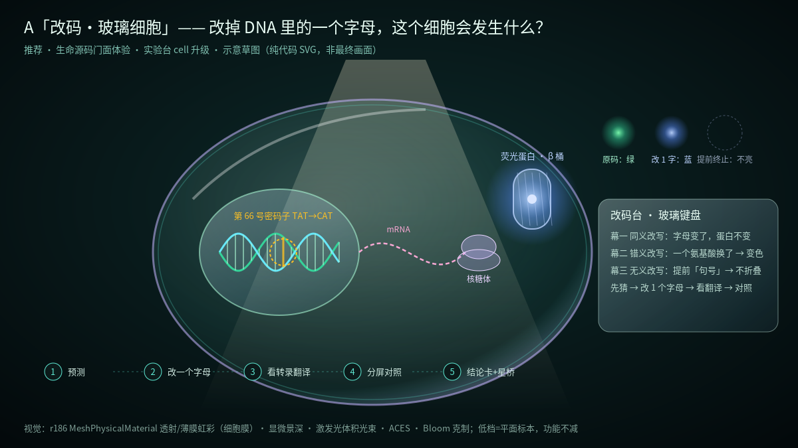
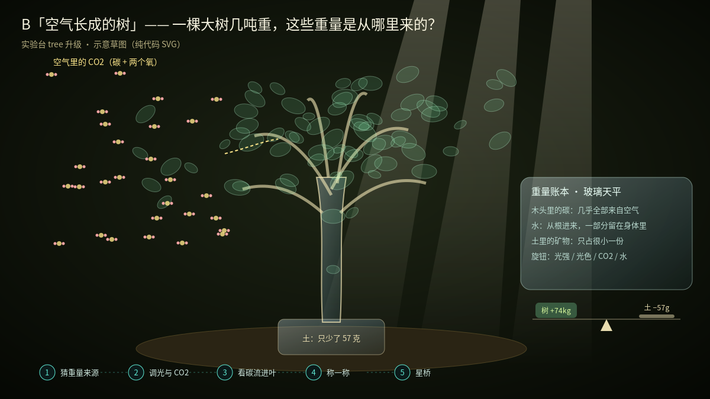
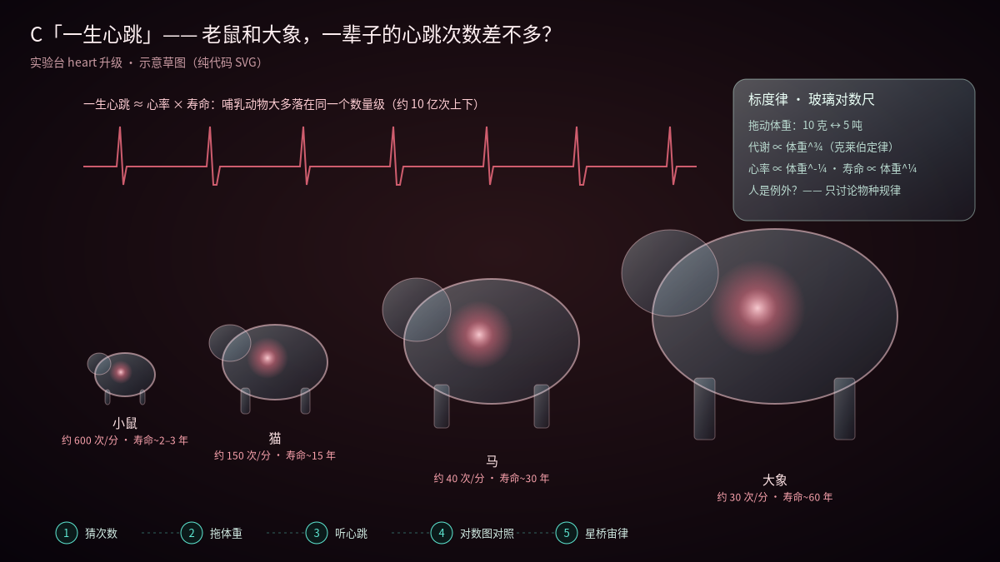

# 生命源码 Life Source 2.0 · 标志性体验方案草图（待老板选定，未开发）

> 2026-11-16 CST · 分支开发（04）· 依总指挥指令 · 只出方案，不改代码、不推送。
> 基线：线上 v0.12 = 9a832c6（2.0 S0：three r186，?three=169 回滚；HUD H1–H3；实验台骨架 /life-source/lab/；SW ls-v0.13）。7 任务：dna、parents、virus、wolf、zebra、rhythm、optogenetics。全站 main d7758b6。
> 参照：05「玻璃心智」、06「心之透镜」、02「改律·玻璃宇宙」——一个世界一个「一句话一问」的门面体验；3D + 玻璃质感 + 电影写实（画质专长包 v4 思路：分层光照、PMREM 环境贴图、玻璃透射/菲涅耳/薄膜虹彩、体积光、景深、ACES、Bloom 克制；低档与减少动态自动降级，功能不减）。
> 示意图：2.0_sketch/A.png、B.png、C.png（纯代码 SVG 渲染，零付费，非最终画面）。

---

## A「改码·玻璃细胞」—— 改掉 DNA 里的一个字母，这个细胞会发生什么？（推荐）

- **核心体验**：走进一颗等身大的电影写实玻璃细胞，在玻璃键盘上改掉荧光蛋白基因里的**一个碱基字母**，亲眼看它被转录、翻译、折叠——绿光变蓝、照旧发绿、或者再也不亮。
- **科学底座（真实且可核）**：维多利亚多管发光水母的绿色荧光蛋白（GFP，2008 诺贝尔化学奖）。发光团由第 65–67 位氨基酸自己形成，藏在 β 桶中央。三幕都只动第 66 位酪氨酸的同一个密码子（野生型 cDNA 为 TAT），每次只改一个字母：TAT→TAC 仍是酪氨酸，蛋白不变；TAT→CAT 变成组氨酸，得到蓝色荧光蛋白（Y66H）；TAT→TAA 是终止密码子，蛋白提前截断、折不成桶、不发光。数值与突变均取文献公认结论，开发时逐条复核并写进 LICENSES/数据来源。
- **玩法循环**：① 先预测（改这个字母，它会变什么颜色？）→ ② 在玻璃 DNA 上改一个字母 → ③ 看 RNA 聚合酶转录、核糖体逐个密码子翻译、多肽在玻璃里折成 β 桶 → ④ 原码/改码左右分屏对照 → ⑤ 结论卡 + 星桥。
- **三幕**（每幕 ≤1 屏文字，七律⑤）：①**同义改写**：字母变了，蛋白没变——为什么密码有冗余？②**错义改写**：一个氨基酸之差，颜色变了（绿→蓝）。③**无义改写**：提前出现「句号」，蛋白折不成桶。收束一问：「源码里的一个字母，什么时候无关紧要，什么时候改变一切？」
- **2.0 视觉**：细胞膜 = r186 MeshPhysicalMaterial 透射 + 薄膜虹彩（真实脂双层本就有干涉色）；细胞核为厚玻璃，内部双螺旋自发光；核糖体半透明磨砂玻璃；荧光蛋白 β 桶为玻璃罐，发光团是唯一的强光源。显微镜激发光做成自上而下的体积光束，浅景深、ACES、轻颗粒，电影写实显微感。降级：中档关虹彩与景深，低档 / 无 WebGL / 减少动态 = 平面标本 + 逐帧示意图，改码与对照功能不减。
- **声音**（七律⑥）：每读过一个密码子一声玻璃轻响，三个碱基一拍；发光那一刻和弦落定。默认关。
- **与实验台 /lab/**：直接把占位的 `cell`（一个细胞里，有多少台机器在同时开工？）升级为第一个 2.0 实验台：新增预设 `recode`（改码），保留 ribosome/motor/atp 三预设为第二层；深链 `?lab=cell&preset=recode`，任务深链 `?task=recode`。
- **与星桥 ls.\***：新任务 `ls.recode` 落在图谱「分子」层；本世界内连 ls.dna（四个字母）、ls.parents（变异如何遗传）、ls.optogenetics（同为「光 + 蛋白」，通道视紫红质也是一段可改的源码）；跨世界连 03 元素工坊（发光团化学、2008 化学奖）、05 奇点前夜（代码与「改一个字符」）。
- **伦理与健康**：只讲荧光蛋白这一类研究工具蛋白；不涉及人类疾病突变、不做医疗或基因检测解读；不鼓励任何实际基因操作。
- **工作量**：约 5 步、5–6 次本地提交：①玻璃细胞场景 + 材质分档 ②密码子模型 + 玻璃键盘（含单元自测：64 密码子表、3 类改写判定）③转录/翻译/折叠动画 + 分屏对照 ④三幕 + 结论卡 + 星桥 + 实验台 cell 接入 ⑤四视口 / 减少动态 / 离线自测 + LICENSES/CHANGELOG + SW 升版。

## B「空气长成的树」—— 一棵大树几吨重，这些重量是从哪里来的？

- **核心体验**：站在电影写实的林间光柱下，一棵玻璃大树从种子长到成材；看空气里的二氧化碳一颗颗被「织」进叶片，再称一称：树多了几十公斤，土几乎没少。
- **科学底座**：17 世纪范·海尔蒙特柳树实验（5 年柳树约增重 74 千克，土只少约 57 克）；光合作用中木头里的碳几乎全部来自空气中的 CO2，水由根吸收，土壤矿物只占很小一份。
- **玩法循环**：猜重量来源（土？水？空气？）→ 调光强、光色、CO2、水 → 看碳流进叶、糖运往树干 → 玻璃天平称重 → 结论卡 + 星桥。
- **2.0 视觉**：玻璃树干内可见糖流光；叶片为薄玻璃 + 叶绿光；林间体积光、晨雾、浅景深。性能压力在大量叶片透射，需实例化 + 分档（低档换不透明叶）。
- **与实验台 /lab/**：升级占位 `tree`（light、co2 两预设）。
- **与星桥 ls.\***：新任务 `ls.tree` 落「个体/生态」层；本世界连 ls.wolf（生态）、ls.rhythm（光与季节）；跨世界连 03 元素工坊（碳循环、光合作用方程）、07 天枢（阳光从哪来）。
- **工作量**：约 4 步、4–5 次提交。画面最「电影」，但题材与已有关卡差异最大，需新写的生物模型最少、美术量最大。

## C「一生心跳」—— 老鼠和大象，一辈子的心跳次数差不多？

- **核心体验**：一排从小鼠到大象的玻璃动物，胸腔里的心脏发光跳动；拖动体重，心跳快慢、寿命长短一起变，最后发现：大多数哺乳动物一生心跳都在同一个数量级（约 10 亿次上下）。
- **科学底座**：克莱伯定律（代谢率 ∝ 体重^¾），由此心率 ∝ 体重^-¼、寿命 ∝ 体重^¼，两者相乘近似不随体重变。只讲物种间统计规律，明确标注「示意模型」；**不推论个人寿命，不做任何健康或运动建议**（人类是明显的例外，正好作为讨论点）。
- **玩法循环**：猜次数 → 拖体重（10 克 ↔ 5 吨）→ 听心跳（声音即规律）→ 普通坐标与对数坐标对照，看曲线变直线 → 结论卡 + 星桥。
- **2.0 视觉**：玻璃动物剪影 + 发光心脏，暗红电影光；对数坐标为悬浮玻璃尺。四只动物、模型简单，性能最省。
- **与实验台 /lab/**：升级占位 `heart`（kleiber、beats 两预设）。
- **与星桥 ls.\***：新任务 `ls.heart` 落「器官/个体」层；本世界连 ls.rhythm（节律）；跨世界连 02 宙律（刚上线的「改律·玻璃宇宙」标度律）、01 星图（幂函数与对数）。
- **工作量**：约 3 步、3–4 次提交，最省力；但健康类题材需老板抽检，画面冲击力弱于 A、B。

---

## 推荐：A「改码·玻璃细胞」

1. **最像「生命源码」**：世界名就是生命的源代码，「改一个字母」直指主题，可作门面体验——与 02「改律」、06「心之透镜」同一套「改规则看后果」（七律②）。
2. **复用最多**：建立在 ls.dna（碱基配对、双螺旋 ls-helix.js）与 ls.optogenetics（光 + 蛋白、3D 全息标本）之上，实验台 cell 占位直接转正。
3. **科学稳、伦理干净**：GFP 突变是公认、可复核的经典结论；不碰人类疾病，避开健康内容风险（C 的风险最高）。
4. **画面最有标志性**：玻璃细胞 + 唯一会发光的蛋白，一张截图就能当 2.0 封面，适合宣发。
5. **可分期**：第一幕（同义改写）+ 场景即可独立上线；B、C 作为实验台 tree/heart 的 2.x 后续。

## 铁律核对

- 只动 /life-source/；不改根 sw.js、index.html，不碰其他世界目录。
- 纯静态、零外部请求、可离线；全部程序生成，若用第三方素材入 LICENSES。
- 科学素养定位，不写培训/提分；生物伦理与健康内容严谨，不做医疗建议。
- 本步未改代码、未提交、未推送；老板选定后才开发，开发只本地提交，由总指挥核后统一推送。
