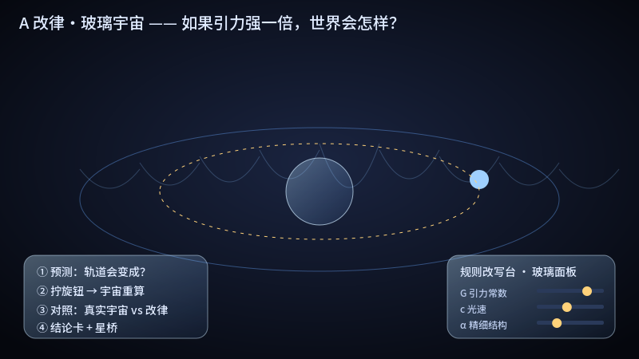
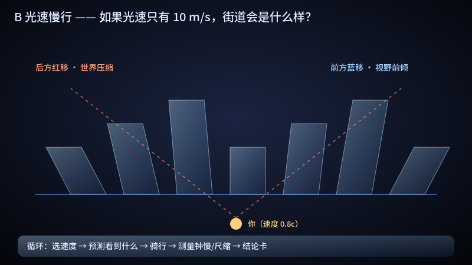
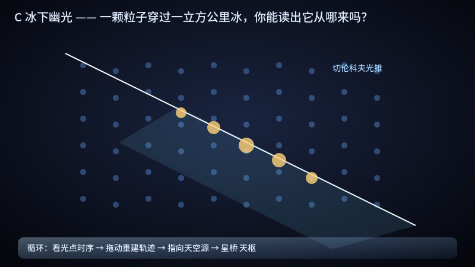

# 宙律 Nomoverse 2.0 · 标志性体验方案草图

> 2026-11-16 CST · 分支开发（02）· 依总指挥指令（王磊 04:17 批准）· 只出方案，不改代码、不推送。
> 基线：线上 v0.9-α9 = b688d87（6 任务 25 关 + 规则改写台 5 实验 + 冰立方特别展；中英双语；three r186，r169 回滚件在）。全站 main e6910a2。
> 参照：05「玻璃心智」、06「心之透镜」——一个世界一个"一句话一问"的标志性体验，3D + 玻璃质感 + 电影写实（画质专长包 v4 思路：分层光照、体积雾、玻璃折射/菲涅耳、Bloom 克制、减少动态有降级）。
> 示意图：2.0_sketch/A.png、B.png、C.png（纯代码 SVG 渲染，零付费）。

---

## A「改律·玻璃宇宙」 —— 如果引力强一倍，世界会怎样？（推荐）

- **核心体验**：在一座电影写实的 3D 玻璃宇宙里，拧动物理常数（G、c、α 等），亲眼看行星轨道、恒星燃烧、原子大小随之重算；再与"真实宇宙"并排对照。
- **玩法循环**：① 先预测（轨道会变成什么？）→ ② 拧玻璃旋钮，宇宙实时重算 → ③ 左右分屏对照真实 vs 改律 → ④ 结论卡（这条定律为什么必须是这个值）+ 星桥。三幕：引力（轨道/潮汐）→ 光速（因果/时间）→ 电磁（原子/化学能否存在），收束到"微调宇宙"一问。
- **2.0 视觉**：中央玻璃星体（折射 + 菲涅耳边缘光），时空网格弯曲用细线体积光；常数面板为悬浮玻璃卡；电影写实星空底（体积雾 + 克制 Bloom）。减少动态：关轨迹拖尾、静帧对照。
- **与规则改写台/星桥**：直接把现有规则改写台 5 实验升级为"玻璃宇宙"的第一层，复用其物理模型与 physics 测试（153 项）；星桥：G → 天枢（恒星演化）、α → 元素工坊（化学键能否存在）、改律思想 → 奇点前夜/觉弈。
- **工作量**：约 4 步、4–5 次本地提交（①场景与玻璃材质 ②常数联动与对照分屏 ③三幕与结论卡 + 中英词条 ④自测四视口/减少动态/离线 + LICENSES/CHANGELOG）。

## B「光速慢行」 —— 如果光速只有 10 m/s，街道会是什么样？

- **核心体验**：把光速调到骑车速度，在一条玻璃街道里骑行，直接看到相对论：前方蓝移、视野前倾，后方红移压缩，钟变慢、尺变短。
- **玩法循环**：选速度 → 预测会看到什么 → 骑行 → 用路边玻璃钟与标尺测量钟慢/尺缩 → 结论卡。
- **2.0 视觉**：玻璃建筑群 + 光行差/多普勒着色的着色器；电影写实街景光照（黄昏体积光）。
- **与规则改写台/星桥**：是规则改写台"改 c"的一个深挖关；星桥：天枢（星光光行差、宇宙学红移）。
- **工作量**：约 4–5 步、5–6 次提交；相对论视觉着色器（光行差/多普勒/探照灯效应）难度最高，物理复核量大。

## C「冰下幽光」 —— 一颗粒子穿过一立方公里冰，你能读出它从哪来吗？

- **核心体验**：置身南极冰层探测器阵列，看切伦科夫光点按时序亮起，亲手重建中微子轨迹并指向天空中的来源。
- **玩法循环**：看光点时序 → 拖动重建轨迹 → 判断能量与方向 → 指向天空源 → 星桥天枢。
- **2.0 视觉**：深蓝冰体体积散射、光点辉光、光锥半透明玻璃体；电影写实冷色调。
- **与规则改写台/星桥**：在现有冰立方特别展 nv.icecube 上做深化；与规则改写台关系弱；星桥：天枢（宇宙中微子来源/超新星，已登记意向）。
- **工作量**：约 3–4 步、3–4 次提交（复用 icecube.js），最省力，但题材较窄。

---

## 推荐：A「改律·玻璃宇宙」

1. **最像"宙律"**：世界名就是"宇宙的规则"，改律一问直指主题，可作宙律的门面体验；B、C 都是其中一个规则的局部。
2. **复用最多、风险可控**：建立在规则改写台 5 实验和 153 项物理测试上，物理正确性有底；B 的相对论着色器复核成本最高。
3. **星桥最广**：可同时连天枢、元素工坊、奇点前夜/觉弈，符合 2.0「星网」。
4. **可分期**：A 第一幕（引力）即可独立上线；B 可作 A 中"光速"一幕的后续深挖，C 留作冰立方特展的 2.x 增强。

## 铁律核对
- 只动 /nomoverse/；不改根 sw.js、index.html；纯静态、零外部请求、可离线；第三方素材入 LICENSES。
- 科学素养定位，不写培训/提分。
- 本步未改代码、未推送；王磊选定后才开发，开发只本地提交，由总指挥核后统一推送。
